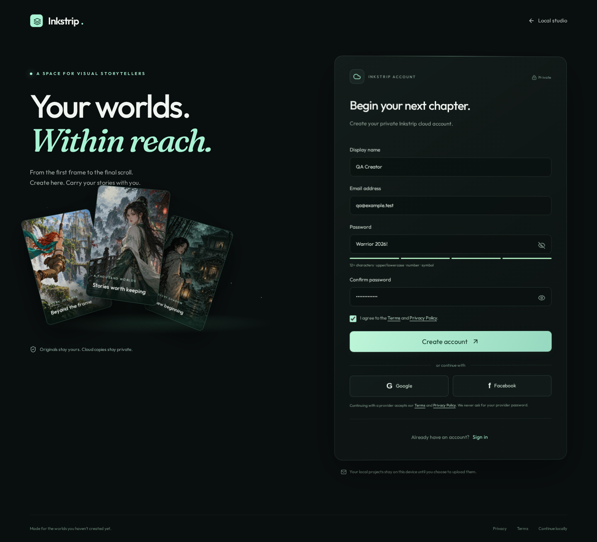
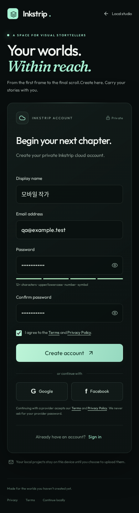
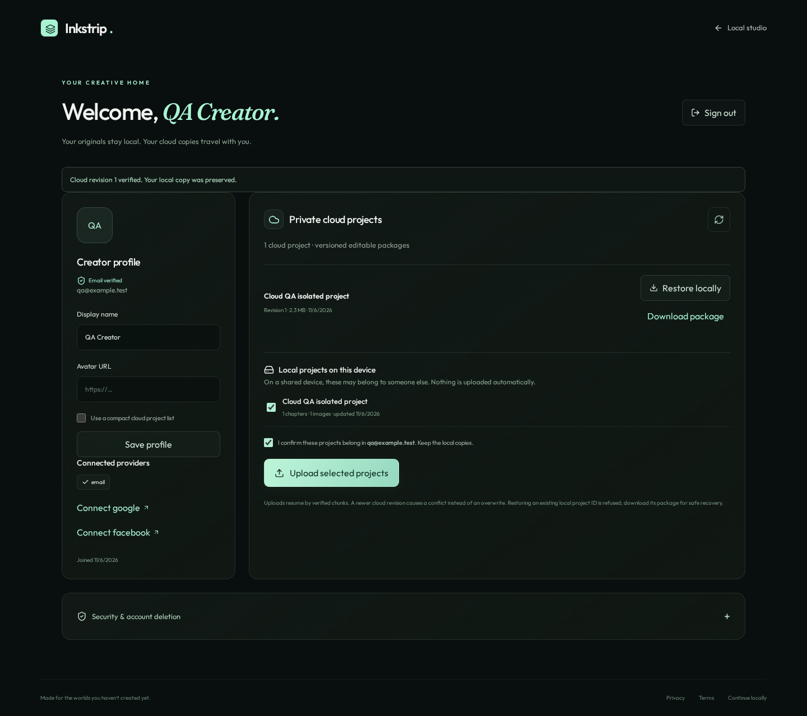

# Cloud accounts implementation report

Branch: `codex/cloud-accounts-cinematic-auth`, based on PR #34/main `55bc1f1`.
Status: implemented and locally verified; **draft PR only, no production deployment**.
Hosted Supabase, email delivery and live Google/Facebook identity flows remain unverified because no external credentials/project were supplied.

## Delivered behavior

- `/account` login, registration, six-digit provider OTP signup/recovery forms, resend cooldown, strength/confirmation validation, password visibility and remembered/session-only login. Clear unavailable setup/provider states; local editing remains accessible.
- Same-origin Supabase backend with HttpOnly/Secure/host-only cookies, PKCE, nonce-bound OAuth callbacks, no-store responses, exact Origin + CSRF checks, confirmed-user authorization, durable hashed rate limits and safe error messages. No browser auth tokens, service-role keys, custom password database, custom email OTP store or runtime mock-auth switch.
- Official Google/Facebook OAuth initiation, callback/cancellation handling, same-user reauthentication and manual identity linking. These require real provider configuration and verification before enabling their flags.
- Profile display name, HTTPS avatar URL, email/verification/provider status, persisted compact-list preference, latest revision sizes, logout, password management and confirmed account deletion. Deletion pauses private access before cleanup, supports retry after partial failure and never removes local projects. Password-change/recovery responses report failed session revocation rather than claiming it succeeded.
- PostgreSQL schema, constraints, profile trigger, RLS on every application table, private immutable package parts, service-only rate/action ledgers and atomic revision publication. User ownership is derived from the provider session, not client data.
- Explicit local project preview, account-specific consent, resumable SHA-256 chunk uploads, duplicate detection and compare-and-swap conflict handling. Existing editable package v3 preserves originals, native Raster sessions, dialogue/Text & Bubbles, Composition & FX, assets and presets. Refresh/retry continues verified uploads. No local copies are removed. Competing revisions require an explicit separate copy; restores refuse existing local IDs.
- Downloaded manifests/chunks are verified before strict existing backup import. Local edits during an upload prevent stale publication. Account changes cancel further transfer. Fresh-device restore is byte-identical for the tested source image.
- Cinematic CSS depth, floating original gallery panels, glass card, lighting, pointer tilt, entrance/focus/loading/success states, touch layouts, reduced-motion support, Terms and Privacy pages. No decorative graphics dependency was added.
- Better Auth scaffold retained inactive. Dependency patched from 1.6.30 to 1.7.18 for the existing critical OAuth advisory; minimal official social API adapters and removal of a cookie-preview log keep the change focused. Its future broker callback allow-list migration is documented separately from Supabase setup.

## Files changed

| Area                         | Files                                                                                                                          |
| ---------------------------- | ------------------------------------------------------------------------------------------------------------------------------ |
| Architecture and operation   | `docs/ACCOUNTS_ARCHITECTURE.md`, `docs/ACCOUNTS_SETUP.md`, this report, `docs/accounts/*`                                      |
| Dependency/test entry points | `package.json`, `package-lock.json`                                                                                            |
| User interface               | `src/components/accounts/account-page.tsx`, `dashboard.tsx`, `accounts.css`                                                    |
| Existing integration         | `src/components/studio/library.tsx` (Account & cloud link), `chrome.tsx` (account/legal access independent of local hydration) |
| Routes                       | `src/routes/account.tsx`, `src/routes/legal/$document.tsx`, `src/routes/api/account/$.ts`, generated route tree                |
| Backend and transfers        | `src/lib/accounts/{policy,config.server,server.server,client,transfers}.ts`                                                    |
| Database                     | `supabase/migrations/202611060001_inkstrip_accounts.sql` (owner-applied, separate from Neon/local storage)                     |
| Security compatibility       | `src/lib/auth/{client,popup.server,gate-session.server}.ts`                                                                    |
| Tests                        | `src/lib/accounts/{policy,server,database}.test.ts`, `scripts/accounts-browser-check.mjs`                                      |

## Verification results

- Full automated suite: **1,202 tests pass** (1,175 existing + 27 account/security/database tests). Provider transport is mocked; database tests execute the actual migration and PostgreSQL RLS in PGlite with Supabase auth/storage schema stubs and real roles.
- Account tests cover registration, policy failures, invalid login, session cookies/restoration, logout, signup/recovery verification, expiry/retry denial, single-use session-bound grants, provider callback/nonce/cancellation/same-account checks, reauthentication, deletion, server-derived project ownership and session-revocation failure handling.
- PostgreSQL tests cover anonymous/unverified restrictions, A/B user isolation, column grants, service-only RPCs, immutable storage paths, receipt verification, stale revision conflicts/idempotency, rate windows, one-use confirmations and deletion-pending access denial.
- Browser workflow: actual forms/IndexedDB/backup/transfer client against a **local-only mocked cloud transport**. Interrupted multipart upload + refresh/resume, deduplication, conflict/separate copy, refusal to overwrite local IDs, tampered download rejection, fresh-device restore/source hash equality, account-switch cancellation and no implicit uploads pass. No real verification emails are sent.
- Desktop and touch 320/360/390/430 px registration/dashboard, password visibility, recovery, refresh and reduced motion pass without horizontal overflow or uncaught errors. Dev and built account smoke screenshots match; built form workflow passes. Provider mocks are confined to the test runner's intercepted requests, never shipped runtime behavior.
- Existing Composition advanced suite passes: nine fade shapes, Bezier/freehand, asset sanitization/persistence, seam pixels, PNG/JPEG/WebP and touch 360/390/430. Existing dialogue suite passes quick/full shared state, history and reopen at 1440/768/320/390.
- Existing Pro suite passes real worker pixels, paint/erase/history/layers/masks, native recovery, PNG/JPEG/WebP, safe chapter application, SVG rejection, touch 320/390, conflict/quota recovery and AI handoff.
- Existing chapter browser suite passes on the built application, including import/stitch/scroll, **real local Swin2SR inference**, comparison/apply/reload/exact original recovery, cancellation, batch enhancement and mobile overflow. No paid AI calls.
- Typecheck, lint, production build, build configuration and legacy auth flag invariant pass. `npm audit --omit=dev` reports **zero advisories**. Browser static assets contain no service-role/rate-secret configuration or Node crypto module.
- Initial graphics browser runs were interrupted by Vite's newly optimized ONNX dependency causing a full-page reload, and one retry overlapped a source reload. These failures were investigated; the source was settled and all named suites subsequently passed. The AI suite was rerun on built output to avoid development reloads. No failure was silently counted as a pass.

## Screenshots

These are actual UI captures with synthetic QA data and a local mocked provider, not evidence of live Google/Facebook login or email delivery.

## Launch and use

Use the repository's existing `npm run dev` entry point. Open **Account & cloud** from the project library. Without external configuration, the real setup state keeps account mutations disabled and offers the local studio. Follow [ACCOUNTS_SETUP.md](ACCOUNTS_SETUP.md) to provision a separate staging Supabase project, apply SQL, configure six-digit/600-second OTP templates and email sender, OAuth credentials/callbacks and server-only Vercel variables. Complete the two-user hosted isolation and end-to-end provider/migration checks there before enabling production or merging.

After verification, select local projects, confirm the displayed destination account and upload. Refresh and retry an interrupted upload to resume it. Download verified packages for recovery or restore on a fresh browser. Account deletion requires a fresh identity confirmation and typed DELETE; local projects remain untouched.

## Remaining limitations and release gates

- Live Supabase provisioning/RLS/Storage, actual email delivery/expiry/notification and Google/Facebook end-to-end sign-in cannot be verified without owner credentials. Account/provider enable flags remain off by default. This is not a claim of a live working production account service.
- Cloud storage uses explicit versioned uploads/downloads, not continuous automatic sync, document conflict merging or a sharing system. Historical revisions and interrupted chunks consume provider storage; owner quotas, monitoring and ledger/audit retention must be configured.
- OAuth reauthentication can reuse provider SSO; it is not phishing-resistant MFA. No adaptive login-risk engine is claimed. Supabase's optional secure-password-change nonce policy requires staging validation before activation. Existing JWTs can survive signout until provider expiry; configure appropriate token lifetimes.
- Large account deletion can require retries within hosting function limits. Backup/audit retention and legal policies require operator review. The profile currently accepts a secure avatar URL, not a dedicated avatar upload flow.
- Package upload is capped at 2 GB/1,000 parts and 2 MiB per request; very large restore/import still obeys existing device memory/image safety limits. Restoring a duplicate local project ID is intentionally refused, with complete package download available.
- Full `npm audit` additionally reports seven moderate **development-only** findings propagated from the existing TypeScript ESLint toolchain’s minimatch 10.2.6 (unchanged from main). Production dependencies have zero findings, and there are no high/critical findings in the full audit. The audit suggests an unrelated tooling downgrade; that change is deferred rather than silently altering the lint stack. See GHSA-g3hv-75wg-m249.
- The inactive legacy broker is not the cloud identity and must not be enabled for Supabase setup. If used separately later, configure the Better Auth 1.7 callback path described in setup docs.

No existing user browser profile was used, no source chapter was deleted or overwritten, no external secret was changed, and main/production were not modified by this feature task.
