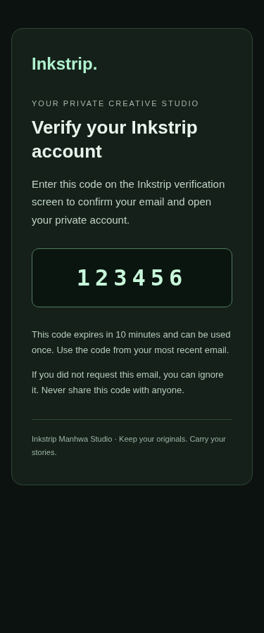
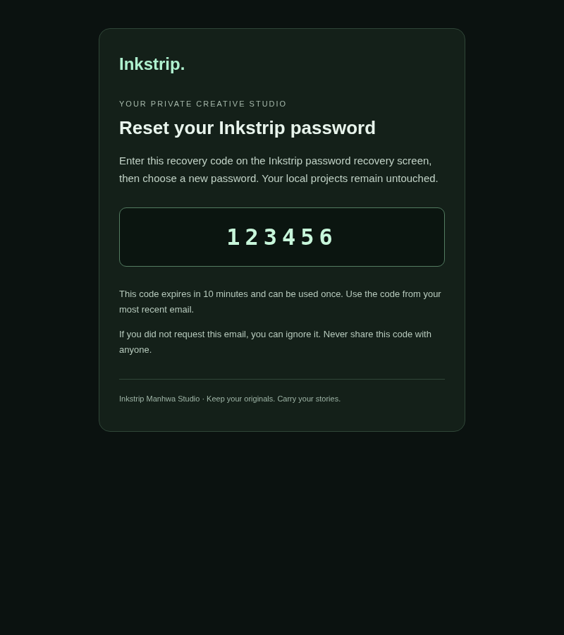

# Live account release — configuration and evidence

This extends PR #35. **The live backend is not yet connected or verified.** Existing local/mock evidence in ACCOUNTS_IMPLEMENTATION.md is not live-provider evidence. No user email address has been supplied for this release session and no real signup/recovery email has been sent. No merge or production deployment is authorized until the specified gates actually pass.

## Current access boundary

The managed environment currently has no Supabase project credentials, Supabase management identity, Vercel management identity, transactional sender credentials or authorized test email. Supabase and Vercel integrations were discovered as available but unconnected. Connecting them to the owner accounts is the smallest first step; never paste API keys, provider passwords or OTPs into a public issue or report. If the integrations do not expose a required configuration operation, the operator must complete that operation in its own dashboard/secret store. Existing GitHub access does not establish permission to read Vercel environment values.

Required owner information after connecting access: the selected existing Supabase project (or an owner-created **Free** project), authorized test email, and existing verified sending domain/provider if any. Google and Meta consent/client configuration may require additional interactive owner authorization. Do not add billing, buy a domain or change subscriptions.

## Free-tier checks (official pages checked November 6, 2026)

| Service                                                                                     | Relevant restriction                                                                                                                                       | Release implication                                                                                                                                                                                                          |
| ------------------------------------------------------------------------------------------- | ---------------------------------------------------------------------------------------------------------------------------------------------------------- | ---------------------------------------------------------------------------------------------------------------------------------------------------------------------------------------------------------------------------- |
| [Supabase Free](https://supabase.com/pricing)                                               | 50,000 monthly active users; 500 MB database; 1 GB file storage; 5 GB egress plus 5 GB cached egress; two active projects; inactivity pause after one week | Use small synthetic files for QA. The app's 2 GB package ceiling is not a free storage allowance. Historical revisions and incomplete uploads also consume storage. No paid upgrade is selected.                             |
| [Supabase default SMTP](https://supabase.com/docs/guides/auth/auth-smtp)                    | Project-team recipients only; currently two messages/hour; best-effort testing service                                                                     | Can test an authorized team-member address within the limits. It cannot support public production email signup. Do not disable verification or add an arbitrary email as an organization administrator to bypass this limit. |
| [Resend Free](https://resend.com/pricing)                                                   | 3,000 transactional emails/month, 100/day, currently three domains                                                                                         | A possible free SMTP option; not yet provisioned or tested. Keep paid overages/add-ons disabled. Check the actual account quota before sending.                                                                              |
| [Resend verified domains](https://resend.com/docs/dashboard/domains/introduction)           | Sending uses a domain the owner controls and verifies in DNS                                                                                               | An existing `vercel.app` website does not grant DNS control over `vercel.app` for email. Owner DNS verification or an existing verified sender is needed for branded public mail. No domain purchase is authorized.          |
| [Vercel Hobby](https://vercel.com/docs/plans/hobby)                                         | Non-commercial personal use; usage limits can pause service                                                                                                | Inspect the existing project's plan and intended use. Do not change the current subscription or silently promise free commercial hosting.                                                                                    |
| [Meta development mode](https://supabase.com/docs/guides/auth/social-sign-in/auth-facebook) | Only app administrators/developers/testers can sign in until required review/live approval                                                                 | A developer test is not evidence of public Facebook availability. Keep the provider's public release state accurate.                                                                                                         |

## Branded email assets, ready for the owner project

- Confirm signup subject: **Verify your Inkstrip account**; body `supabase/templates/confirm-signup.html`.
- Recovery subject: **Reset your Inkstrip password**; body `supabase/templates/recover-password.html`.
- Password-change security notification: `supabase/templates/password-changed.html`; enable the provider notification separately.
- The code templates use the official `{{ .Token }}` variable once, never a fixed code or a client-side validation flag. Configure **six digits / 600 seconds** in Supabase before publishing the templates. The templates contain no tracking pixels, scripts, external artwork or password values.
- Choose From name **Inkstrip Manhwa Studio**, with a From address on the owner's verified sending domain. Store SMTP credentials in Supabase, not in Git or browser variables. Verify SPF/DKIM/DMARC, deliverability and actual message headers.
- Template files are prepared source assets. They are **not applied to a hosted provider** merely by committing them.

## Real authorization checker

`npm run test:accounts:live` is separate from every mocked/browser/unit suite. It requires server-side `SUPABASE_URL`, `SUPABASE_ANON_KEY`, `SUPABASE_SERVICE_ROLE_KEY` and an explicit `INKSTRIP_LIVE_QA_ENABLED=true` opt-in. Missing credentials produce **blocked**, exit code 2, not a passing result. Never add the live flag to ordinary CI or production runtime settings.

Once access is configured, the checker contacts the actual Supabase Auth/PostgREST/Storage services. It creates fresh synthetic `@example.invalid` identities with cryptographically random temporary passwords and a server-owned run marker, including one unverified identity. Admin fixture creation sends no email. It checks own/foreign/anonymous profile/project/revision/chunk access, bucket privacy, storage ownership/immutability, protected columns, service-only publication RPCs, actual refresh and provider rejection of a logged-out refresh token.

Cleanup is restricted to identities created in that invocation and rechecked against the server-owned run marker. It removes only tracked fixture object paths and then those fresh synthetic users, never lists or deletes unrelated accounts/projects. Cleanup failures are explicit and retain the run/fixture identifiers for narrowly scoped operator recovery. No password, access token, refresh token or email OTP is printed, snapshotted or saved. The checker is not an email, browser/BFF, OAuth or natural token-expiry test; those are separate mandatory gates below.

Guard tests for this runner use fake transports solely to test refusal, cleanup ownership boundaries and diagnostic redaction. A passing guard test does not establish any live service result.

## Mandatory live gates and evidence to collect

1. **Backend configuration:** select the owner project and Free plan; inspect existing tables and policies before applying the supplied migration. Never rerun by dropping tables or make the bucket public. Confirm all application RLS, grants, service-only functions and absence of conflicting permissive Storage policies. Validate URL/SMTP/provider settings through authorized management access. Configure a dedicated Vercel staging/branch target with server-only variables before enabling production.
2. **Real signup and recovery:** use only the email explicitly supplied by the owner. Confirm whether it is already an existing account; never delete it or overwrite its projects. Use a temporary Inkstrip-only password. Trigger real delivery from the app, let the owner enter codes securely, verify single use, latest-code behavior, expiry after 600 seconds, controlled resend/attempt limits, password change notification, login/logout and refreshed sessions. Record timestamps/outcomes, not OTPs or passwords. Respect provider limits; do not disable them for testing.
3. **Actual direct API isolation:** run the live synthetic checker and inspect the non-secret report. Verify private bucket behavior directly, not just UI visibility. Test deletion protection through the actual app with a fresh dedicated fixture; do not delete the owner's existing account.
4. **Real browser/editor package:** create a new synthetic local project, original image, native Raster edit, dialogue edit and Composition/SFX layer. Explicitly upload, interrupt/retry, refresh, sign out/in and restore in a fresh browser. Compare original file hashes and editable state. Do not use or remove an existing user browser profile. Repeat desktop/mobile and reduced-motion checks against the configured hosted backend.
5. **OAuth:** configure official Google/Meta clients in the owner dashboards. Provider redirect URI is the Supabase `/auth/v1/callback`; app redirect is its `/api/account/callback` with the flow query allow-list described in ACCOUNTS_SETUP.md. The owner completes provider consent securely. Confirm same identity/session/profile, cancellation, returning login, wrong-account reauth denial and mobile behavior. Record whether Meta is test-role-only or approved for public use. Leave unavailable providers clearly disabled.
6. **Release:** fix actual failures, rerun affected checks and all required GitHub CI on the exact head. Only after the preceding mandatory gates pass, mark PR #35 ready, perform a normal protected merge, await the existing Vercel production integration, verify the production commit marker and repeat live desktop/mobile auth/storage smoke checks. Do not deploy a passing mock as a substitute for hosted verification.

## Evidence status for this continuation

| Gate                                                        | Status                                                                                    |
| ----------------------------------------------------------- | ----------------------------------------------------------------------------------------- |
| Existing implementation / local/mock tests                  | Implemented; prior evidence retained, 1,202 tests at prior feature head                   |
| New live-runner guard tests                                 | Local safety checks only; not hosted authorization evidence                               |
| Supabase connection / migration application / RLS / Storage | Blocked by owner access and project selection                                             |
| Real verification/recovery delivery                         | Blocked by authorized email, project connection and sender configuration                  |
| Google / Facebook                                           | Blocked by provider credentials/owner consent; public Meta approval must be distinguished |
| Real full-project browser recovery                          | Blocked by actual hosted backend credentials                                              |
| Production auth release                                     | Not merged or deployed; no merge SHA                                                      |

## Verified independent work in this continuation

- The previous PR head `f1732f6` completed **all five GitHub workflows successfully**, including Raster continuity, real-AI and production/main regression checks. This is not a live-authentication approval.
- Four live-runner guard tests and the 27 existing account/policy/PostgreSQL tests pass locally. Typecheck, lint, production build and build-configuration checks pass. Existing successful editor results remain valid: this continuation changes no editor or account runtime behavior.
- All three prepared email templates rendered without overflow at 375 px and 800 px (six browser renders). The images below use a synthetic illustrative code; no actual verification/recovery code was collected.
- The actual live command was invoked without credentials and correctly returned **blocked** / exit 2. It created no identities, sent no email and made no remote database changes.
- Supabase and Vercel connections are still unconfirmed. The owner test-email question is pending. Do not mark the hosted-service gates passed from any of the preceding local results.

