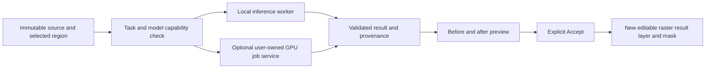

# Phase F — AI Studio architecture preparation

Status: scaffold retained as design context; executable F1 foundation is documented in
`PHASE_F1_AI_STUDIO.md`. F2–F5 remain unavailable and require explicit approval.
Branch starts from the verified Phase E production release
`ced5907f5e0bfc49e72588fe76d3cbf652d39b7f` (PR #4).
No model installation, training, GPU service, paid API/subscription, credential,
environment variable or production configuration change is part of this branch.

## Reuse the current application

- Keep `src/lib/studio/enhance/{client,worker,types}.ts`: the existing
  `EnhancementEngine.run/dispose` worker, progress/error contract, local ONNX/WASM
  inference, model cache and immutable image handling. Swin2SR is real neural
  restoration, not generative face/anatomy repair. The production release test
  verified 16×24 → 32×48 inference; it did not qualify other models.
- Its checkpoint is pinned to Xenova Swin2SR revision
  `93dfc9089abda257351d3a58d5771e2c1ff69442`; preserve the existing runtime assets,
  WASM single-thread fallback, transparency handling and 4 MP / 4096-side input
  guard. Final 1× also uses a bounded 2× intermediate.
- Keep `src/lib/studio/pro/{model,storage,files,render,masks}.ts`, immutable asset
  references, native v5, exact mask frames, document source, crop/transform/layer
  relationships, undo and Chapter expected-media/revision checks.
- Keep the existing guarded optional adapter in
  `src/lib/ai/image-edit.server.ts`. It currently uses a separately configured
  paid provider, owner access, same-origin checks, a 4 MB upload bound and bounded
  PNG context/mask/reference inputs. **Do not route new tasks to it automatically,
  enable credentials, invoke it in QA or add paid providers without authorization.**
- Traditional selection, texture repair and filters retain their current names;
  they must never be substituted for advertised trained-model inference.

## Proposed execution boundary

Use one typed job facade for supported tasks, with model manifests declaring:
checkpoint revision/hash, separate code/weights licenses, input shape/color/alpha,
region limits, backend, download bytes, measured memory, cancellation method,
reference support and qualified tasks. Capabilities must be based on tested model
behavior; a generic inpainting checkpoint is not automatically a qualified
hands/anatomy or identity-restoration model.

Job states: idle → preparing/downloading → running → preview → accepted, failed or
cancelled. Rendering and inference use separate workers so a model does not block
paint/selection interaction. One inference job per document initially; bounded
queue, download/runtime timeouts, explicit disposal, worker/GPU-loss recovery and
no silent retries that upload artwork or spend money.

Capture the immutable input asset IDs, region/mask frame, selected references,
accepted Chapter blob, document generation/revision and model manifest at start.
Before accepting, compare these against current state. Stale results go to an
explicit review/rebase workflow; never overwrite intervening edits. An initial
implementation may require the input document to stay unchanged during a job.

## Candidate models and qualification limits

Public upstream sources inspected on 2026-10-23; this is evaluation, not a shipping
license approval or a claim of manhwa quality. Pin and review the actual weight
artifacts and dependency notices before any distribution.

| Candidate | Possible role | Current evidence and restriction |
| --- | --- | --- |
| Existing Swin2SR ONNX | Detail enhancement/restoration | Already implemented and production-tested locally in the browser. Does not invent corrected anatomy, enforce character identity or perform generative inpainting. |
| [GFPGAN](https://github.com/TencentARC/GFPGAN) | Face-crop restoration candidate | Upstream [LICENSE](https://github.com/TencentARC/GFPGAN/blob/master/LICENSE) states Apache 2.0 with listed third-party exceptions. Qualify exact weights/dependencies separately. Human-face priors can distort illustrated faces/identity; no manhwa acceptance result or runtime benchmark here. |
| [CodeFormer](https://github.com/sczhou/CodeFormer) | Research comparison for face fidelity | Upstream [S-Lab License 1.0](https://github.com/sczhou/CodeFormer/blob/master/LICENSE) explicitly permits non-commercial use and directs commercial users to obtain permission. Exclude from a commercial/default distribution until appropriate permission is established. |
| [LaMa](https://github.com/advimman/lama) | Background/object-removal inpainting candidate | Repository [code license](https://github.com/advimman/lama/blob/main/LICENSE) is Apache 2.0. Review exact checkpoint/data terms separately and test speech-bubble borders, panel lines and repeated patterns. It does not guarantee new correct faces/hands. |
| Diffusion inpainting with optional reference conditioning | Anatomy repair/reference-guided editing research | Not selected, installed or benchmarked. Select a checkpoint and adapter only after reviewing their own model cards/weights licenses, commercial terms and illustrated-character quality. Do not assume a framework's code license licenses every model. |

Reference identity embeddings/FaceID adapters require independent weight-license
review; do not assume a reference adapter or human-face recognition checkpoint is
commercially usable or appropriate for manhwa. Perfect character preservation is
not promised. User-owned/licensed evaluation and training material is required.

## Browser, CPU and GPU feasibility

The verified baseline is Linux / AMD EPYC 9V74 / Chromium 156 with existing WASM
Swin2SR. No new checkpoint was executed and no GPU performance/VRAM measurement was
made; `nvidia-smi` is unavailable in this execution environment. Do not publish
invented latency, VRAM requirements or physical Android claims.

- Browser first for the established Swin2SR path and bounded crop experiments
  that actually pass ONNX operator, memory, download and cancellation tests.
  Capability-detect WebGPU; retain a truthful supported CPU/WASM path where viable.
  Missing backend/model means unavailable, never a simulated result.
- Face models require checkpoint-specific crop sizes, alignment, normalization,
  operator conversion and undoable placement. CPU latency and fidelity must be
  measured before offering them on phones. Photographic training is an explicit
  domain-mismatch risk, not evidence of illustration repair.
- Diffusion weights, repeated denoising and intermediate buffers make general
  mobile-browser inference a research path, not the default plan. Measure actual
  checkpoint/precision/device memory before choosing a GPU target or minimum VRAM.
- If generative inpainting needs a server, use an explicitly configured user-owned
  GPU worker outside short-lived Vercel request execution. Vercel may coordinate
  bounded jobs; do not host long GPU inference inside the current app functions.
  No server/GPU provisioning or billable service is authorized by this preparation.

## Data, editing and persistence

Prefer region-only inputs with a documented context halo. Local jobs keep artwork
on-device. Server jobs require explicit upload consent for context/mask/reference,
size/time limits, temporary retention and deletion policy; never log image bytes,
access keys or character references. Keep server credentials server-only. Never
accept arbitrary model code or artifact URLs from documents/imported files.

Validate result dimensions, format, finite placement, alpha/color convention,
model provenance and current device/asset budgets before committing. Preserve
outside-mask pixels by putting the result in a new masked raster layer, rather
than replacing the source bitmap. Preserve input transparency unless the chosen
task explicitly edits it. Acceptance is one undoable transaction; failure/cancel
leaves all document and Chapter data unchanged. Preview is compare/overlay/split,
with clear model/task limitations and an explicit Accept/Discard choice.

Native records should retain result blobs, source IDs, mask/frame, model revision
and hash, seed/settings, references and a small provenance receipt. No secrets or
remote URLs required to reopen an accepted result. Save no temporary tensor caches
or whole inference history. If new native fields need an envelope version, provide
an additive migration from v5 and retain v1–v5 reading; never silently flatten or
drop unknown AI data. A seed/model receipt helps replay but is not a promise of
bit-exact GPU reproducibility.

The existing source/portable-file budgets still apply. Oversized output must be
rejected before insertion with recoverable work intact; do not silently downsample
or replace original artwork to make a result fit.

## Proposed independently testable milestones

1. Model manifest/job facade and non-destructive result layers; reuse actual
   Swin2SR first to prove progress, cancellation, stale-job rejection, native
   round trips, exact untouched regions, previews and Chapter preservation.
2. Qualify one legitimately licensed local/owned-server restoration or inpainting
   model on representative licensed manhwa fixtures. Keep unavailable tasks out
   of the functional toolbar.
3. Region inpainting/background/line-art evaluation, then face/eyes/mouth and
   hands/anatomy only when measurable quality supports those labels.
4. Reference-based consistency and multi-panel identity evaluation after licensing,
   style/identity fidelity, pose variation and explicit reference handling pass.

Every milestone needs real-inference integration tests, pixel/alpha boundaries,
cancel/stale/quota/network failure tests, native/save/reopen/history/export tests,
measured CPU/GPU/browser/download/memory results and desktop/320/390px touch QA.
Use held-out fixtures and human review for style/identity/anatomy; ordinary image
similarity alone cannot prove anatomically correct reconstruction. Preserve the
Phase E baseline of 677 tests / 19 Chromium suites, Raster/Vector/Chapter, actual
Swin2SR and homepage 3D. The current Phase F user policy requires an explicit approval checkpoint for each
release. Do not merge, deploy or start F2–F5 automatically. See `AGENTS.project.md`.
