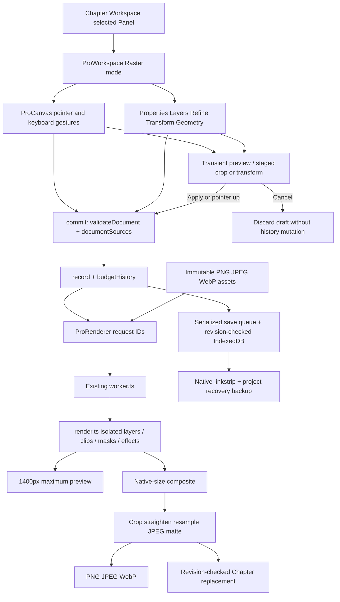

# R1 — Raster control and data dependency map

Source baseline: `a90c656c8b68cb2016a7a1cd09e720ef3ed145ab`. This map describes the existing shared engine, not a replacement architecture. Paths below are relative to `src/` unless stated otherwise.



## Source catalog and interpretation

`CONTROL_INVENTORY.json` catalogs **259 JSX control definitions across 11 shared surfaces**, including map-generated templates, Radix menu/confirmation items and conditionally visible shape/text controls. `pro-tools.ts` separately defines the mode-filtered tool list. Regenerate from repository root with:

```sh
node docs/raster-completion/generate-control-inventory.mjs
```

The catalog records source locations, labels, sections, handler expressions, values and local disabled props. It is a source inventory, **not proof that259 distinct controls are simultaneously rendered or individually browser-tested**. Inherited fieldsets, selection/type gates, mode filters, parent callbacks and Radix composition must also be inspected. Conditional vector controls are retained because Raster can select vector/text layers; vector-only inspector tabs are excluded from Raster navigation. This table traces their command families to real state and pixel consumers.

## Raster rail: every advertised tool

| Visible tool / ID                    | Input → command / document data                                                                                                 | Real consumer and verification                                                                                                                                                         |
| ------------------------------------ | ------------------------------------------------------------------------------------------------------------------------------- | -------------------------------------------------------------------------------------------------------------------------------------------------------------------------------------- |
| Move / `move`                        | `ProCanvas.begin/update/end` → `translateLayers`, `onCommit`; selected/linked roots and descendant transforms                   | `transform.ts` mapping → `render.composite`; layers/transform suites, source coordinate/lock tests                                                                                     |
| Free Transform / `transform`         | `chooseTool` → staged `TransformDraft`; Apply → `transformDocument/transformForest`; Cancel discards                            | Inverse affine/homography/3×3 warp sampler; transform/color/raster suites; group nonlinear guarded                                                                                     |
| Crop / `crop`                        | Eight pointer handles and numeric `Crop` draft → `applyCrop` → `doc.crop`                                                       | `output.renderOutput` after composite; geometry suite checks native output, cancel and source retention                                                                                |
| Hand / `hand`                        | Pointer/space-pan and two-pointer pinch → local viewport state                                                                  | Canvas screen-to-document mapping; no document change/history/save expected; geometry/transform/Pro touch suites                                                                       |
| Brush / `brush`                      | Coalesced input → `brushPoint` → `Layer.strokes` or `mask.strokes`; one committed gesture                                       | `brushDabs`, `render.stroke/clippedStroke`, shared composite; seeded/pressure/spacing and worker pixel tests                                                                           |
| Pencil / `pencil`                    | Same stroke pipeline, forced square hard tip                                                                                    | Exact native replay; selection/Pro suites verify actual clipped pixels                                                                                                                 |
| Eraser / `eraser`                    | Stroke erase flag; inverted-mask painting reverses coverage semantics                                                           | Destination-out on editable paint/mask surface; source raster remains immutable; refinement/Pro tests                                                                                  |
| Clone Stamp / `clone`                | Alt/touch-arm source → immutable full-document texture snapshot; aligned offset and captured transform stored in `stroke.clone` | Shared paint renderer inverse maps source; Pro/repair suites include native ID remap, source protection and selection clipping                                                         |
| Healing Brush / `heal`               | User source + target footprint → renderer repair request → processed donor asset and `stroke.repair` in one action              | `repair-worker.ts`, spatial normalized convolution in `repair.ts`; actual damaged-pixel/alpha/export tests                                                                             |
| Spot Healing / `spot`                | Native footprint → bounded translated donor search → immutable processed texture                                                | Local context/color/texture score, not semantic synthesis; repair suite and unit tests                                                                                                 |
| Patch Repair / `patch`               | Destination rectangle then source-center tap; brush hardness gives edge softness; selection captured                            | Native equal-size translated patch plus spatial tone adaptation; invalid/out-of-bounds/cancel/history/export tests                                                                     |
| Eyedropper / `eyedropper`            | Canvas sample → brush color and optional selected vector fill                                                                   | Reads displayed preview pixels (not a native analysis request); this differs from Magic Wand and Refine color sampling; source trace is verified, native-precision sampling is partial |
| Paint Bucket / `fill`                | Native color analysis → intersect active selection → `bucketStroke` square coverage dabs on paint layer                         | Existing stroke/RLE pipeline; fill unit tests and Raster browser checks; bounded source region fragmentation                                                                           |
| Rectangle / ellipse selection        | Source-coordinate gesture → `Region` → `appendSelection` → `doc.selection`                                                      | `selectionCanvas`, captured stroke clips/masks; Pro/geometry/refinement tests                                                                                                          |
| Freehand / polygonal lasso           | Recorded polygon / Enter-close → lasso Region and Boolean selection state                                                       | Canvas coverage and local-frame mapping; selection tests; no magnetic edge algorithm claimed                                                                                           |
| Magic Wand / `wand`                  | Native worker composite → four-connected, seed-relative `selectColor` → row-bounded RLE                                         | Tolerance/contiguous/AA and Boolean coverage, beyond-preview isolated pixel tests                                                                                                      |
| Color Range / `color-range`          | Same native worker analysis, all matching pixels instead of connectivity                                                        | Exact RLE coverage; source-resolution transparency/AA/native history tests                                                                                                             |
| Rectangle / ellipse / line / polygon | Pointer bounds → actual shape layer; styling in Properties                                                                      | `paths.ts`/Canvas vectors; native/SVG/transform/appearance suites                                                                                                                      |
| Pen / direct select                  | Cubic anchors/handles/contours, insertion and editing → immutable layer metadata                                                | `anchor-edit`, `bezier`, `compound`, shared vector renderer; vector/compound/anchor suites                                                                                             |
| Text / `text`                        | Actual text layer creation; Properties → typography fields                                                                      | Existing native Canvas and supported SVG; Vector/Dialogue regression suites. Enhanced text and path text retain their separate workflows                                               |

Raster does not show the Vector Gradient, Text-on-Path or Artboard tools. Their working implementations remain in Vector Studio; switching mode preserves the shared document. No duplicate Raster tool is invented in this audit.

## Header, contextual bar and inspectors

| Control family                                                                                                             | Handler / state                                                                                            | Rendering, persistence and failure behavior                                                                                                               |
| -------------------------------------------------------------------------------------------------------------------------- | ---------------------------------------------------------------------------------------------------------- | --------------------------------------------------------------------------------------------------------------------------------------------------------- |
| Raster/Vector/Dialogue navigation, close/back                                                                              | `onModeChange`, `onDialogue`, `close`, serialized `persist`                                                | Same editable session; safe save before closing; no crop/transform draft silently committed                                                               |
| Save draft; stale-image adopt/recovery                                                                                     | `saveNow`, `persist`, `adoptLatestImage`, native export                                                    | `storage.saveSession(expectedRevision)` aborts conflicts; saved source separate from accepted Chapter revision                                            |
| Undo/Redo/history list                                                                                                     | `actions.current`, `editor/history`, `budgetHistory`                                                       | 50 past metadata entries + current;32MiB soft accounting, nearest undo/redo retained; history timeline not embedded in native files                       |
| Save to Chapter / AI handoff                                                                                               | `apply` → persist → worker native export → `replacePanelImage(expectedBlobId)` → persist accepted revision | New composite retained separately from original; stale Chapter revision blocked; existing AI panels only; F1 not integrated                               |
| Grid/Snap                                                                                                                  | `doc.layout.grid/snapping` through `commit`                                                                | Persisted layout; snapping candidates use source geometry and zoom-aware tolerance; richer settings in Vector Precision panel                             |
| Imported source comparison                                                                                                 | Local `before` state → original-reference-only render                                                      | View-only; disables edits while comparing; source bytes retained                                                                                          |
| Selection add/subtract/intersect, Select all, invert/deselect, feather                                                     | `operation`, `setSelection`, `appendSelection`; native selection metadata                                  | Active selections clip subsequent edits, not whole export/merge; selection/Pro suites test inverted Boolean semantics                                     |
| Tolerance, contiguous, anti-alias                                                                                          | Local settings supplied to worker `selectColor` for Wand/Range/Bucket                                      | Source-resolution pixel algorithm; these UI settings alone do not edit document until sampling                                                            |
| Fullscreen / inspector toggle / width                                                                                      | Browser fullscreen API; local panel state                                                                  | View-only; fullscreen rejection surfaces usable error, not artwork mutation                                                                               |
| Brush source arm/aligned toggle                                                                                            | `captureCloneSource` full-canvas export, `cloneSource` state                                               | Embedded immutable source snapshot published only after valid operation; offset advances for aligned strokes                                              |
| Brush size/hardness/opacity/flow/color; smoothing/pressure/dynamics/reset                                                  | `onBrush` → `doc.brushSettings`; new strokes capture settings and seed                                     | `brushPoint/brushDabs` native replay; recorded pen pressure only; existing strokes unchanged                                                              |
| Presets choose/save/rename/duplicate/delete                                                                                | `brush-presets.ts`, shared document settings + bounded browser storage                                     | Factory/custom recipes validate and persist; image-tip import, portable preset packs absent                                                               |
| Properties name/opacity/blend/transform/reset                                                                              | `patch` validates inherited locks and whole document                                                       | Real layer metadata used by compositor and native export; invalid transforms rejected; supported16blend modes                                             |
| Shape fill/no-fill/stroke/width/fill rule/tail/anchors                                                                     | `patch`, `editAnchor` and contour utilities                                                                | Actual editable paths; non-default appearance stacks route to Vector Appearance instead of conflicting basic controls                                     |
| Typography text/font/size/weight/line-height/letter-spacing/align/fill                                                     | `patch` with legacy lettering reconciliation                                                               | Native worker text, font-resolution and XML-safe SVG. Separate text-path settings remain Vector-only                                                      |
| Brightness/contrast/exposure/saturation/temperature/sharpen/noise/blur                                                     | `Layer.adjustments` → `applyAdjustments`                                                                   | Deterministic encoded-RGB algorithms; box blur, bounded unsharp and3×3edge-aware noise reduction; not a general professional filter stack                 |
| Hue/black/white/gamma/five curve points/Black & white                                                                      | `tonePixels`, saturation shortcut                                                                          | Piecewise-linear five-point curve, not free-form splines; alpha preserved                                                                                 |
| Color Balance/Vibrance/Channel Mixer/Shadows-Highlights/Gradient Map/Threshold/Posterize                                   | `ProColor`→`Layer.color`, optional captured `colorSelection`                                               | Fixed documented color pipeline, masks/selections; color/appearance suites validate native math/export                                                    |
| Add gradient layer; linear/radial, center/scale/angle/stops/reset                                                          | `ProLayers.onAdd`→`Layer.gradient`; `GradientFields/GradientStops`                                         | Native `gradientPixels` premultiplied interpolation; editable native metadata; appearance suite                                                           |
| Add adjustment layer                                                                                                       | `Layer.kind=adjustment`, same tonal/color controls                                                         | Transforms/masks define coverage; affects lower siblings in isolated group; preserves backdrop alpha                                                      |
| Seven layer effects enable/params/order/reset/remove                                                                       | `Layer.effects`→`effectPixels/effectPadding`                                                               | Exterior/interior planes in fixed semantic order; true pixel styles, bounded padding; appearance/refinement/export tests                                  |
| Mask from selection / paint / copy / paste / link / invert / enable / density / feather / remove                           | `maskFromSelection`, `copyLayerMask`, `setMaskLinked`; `mask.strokes`                                      | Native mask coverage; affine linked/unlinked mapping; copy/link of deformed mask guarded; preview/native/refinement tests                                 |
| Bake layer and mask (explicit destructive action)                                                                          | Worker `apply-mask`→new PNG/metadata, immutable pool retained                                              | Raster/paint only; original retained; one Undo; actual bake pixel comparisons; group bake not exposed                                                     |
| Layers select/multi-select/ranges/collapse/rename/lock/show/link/clip/reorder/group/move-to-group/ungroup/duplicate/delete | `ProLayers`→`layers.ts/operations.ts`, shared `commit`                                                     | Hierarchy/lock/clipping invariants validate; source assets shared immutably; guarded ungroup/backdrop cases; layers suite                                 |
| Merge selected / visible / Flatten + Keep layers                                                                           | `planMerge/finishMerge`→worker before/after native pixel validation                                        | Actual geometric stack flattening, explicit confirmation for full flatten, hidden retention where supported; publish only if valid; max1channel tolerance |
| Simple left/center/right alignment                                                                                         | `patch` using transformed bounds                                                                           | Actual layer transform; richer multi-object alignment/distribution in Vector Precision; snapping remains available in Raster                              |
| Crop handles/aspect/position/size/straighten/Apply/Cancel/Reset                                                            | `Crop` draft then `doc.crop`                                                                               | Source canvas/layers preserved; output coordinates applied after composite; geometry suite                                                                |
| Image-size width/height/aspect/filter/reset                                                                                | `doc.imageSize`                                                                                            | Final composite nearest/bilinear/bicubic/Lanczos resampling, alpha-safe, widened downscale kernel; no layer-source resample                               |
| Canvas width/height/apply                                                                                                  | `doc.width/height`, top-left anchor                                                                        | No resampling or source deletion; exact export bounds; no arbitrary canvas anchor control                                                                 |
| Transform modes/handles/pivot/flip/shear/dimensions/rotation/reset/Apply/Cancel                                            | `TransformDraft`→single validated history transaction                                                      | Homography or bounded9point warp for single object; affine forest for groups; inverse mask/hit mapping; transform suite                                   |
| Refine parameters/samples/previews/live toggle/Apply/Cancel/output-mask/save/load/delete selection                         | Worker `refineTiled`, `ProRefine` staged coverage → `setSelection/maskFromSelection`                       | Native morphology, local color-line matting, box-filter feather, connected components; no RGB decontamination/semantic model                              |
| Assets import/place                                                                                                        | `importFile`/`addAsset`, `readNative`, `mergeNativeSession`, `importSvg`                                   | Native remaps assets and retains undo pool; sanitized SVG parsed to geometry; standalone raster R1 fix preflights header/bytes before decode              |
| AI tools buttons                                                                                                           | `apply` then existing Enhance/Image/Face workflow                                                          | Swin2SR real local inference; optional cloud features retain configuration/consent boundary; not F1 integration, no new network submission                |
| Export editable/native; vector-only SVG; format/quality/composite/background                                               | `exportFile`→`nativeFile/vectorSvg/worker.export`                                                          | Native exact referenced assets; PNG/JPEG/WebP native output; SVG explicitly vector-only/guarded; failed encoding/import never substitutes a success       |
| Progress/cancel                                                                                                            | `cancel`→`operationRun`, renderer disposal/reinitialization                                                | No partial worker result committed; cancellable stages only; synchronous header/JSON parse is bounded but not cooperatively cancellable                   |

## Shared dependencies and ownership

- `lib/studio/pro/model.ts`: internal document version1, seven existing layer kinds, strict values, references, graph and command budgets. Native envelope versions are a separate compatibility mechanism.
- `lib/studio/pro/render.ts`: one compositor for preview, merge/selection/repair sampling and export; `worker.ts` schedules bounded operations and owns decoded bitmap LRU.
- `lib/studio/pro/{transform, transform-pixels, transform-transaction, masks}.ts`: source/document mapping, homographies/warp and mask plane ownership.
- `lib/studio/pro/{files, native-images, storage}.ts`: portable envelope parsing, immutable asset remapping, image preflight and revision-checked local persistence.
- `lib/studio/{store, db, backup}.ts` plus `dialogue/storage-compat.ts`: Chapter metadata/media transactions, original bytes and project recovery journal. Chapter/general-format image imports use a separate decode path; see H02 in the audit.
- `lib/studio/editor/{history, adjustments}.ts`: reused history and deterministic RGB operations; no new history or filter engine.
- `lib/studio/enhance/*` and existing model/ONNX workers: existing real Swin2SR, not unreleased F1.
- `lib/studio/pro/{svg-import, vector-render, vector-svg, appearance, compound, pathfinder,...}`: shared Vector behavior, retained and regression-tested. No dependency on F1 branch is introduced.

See `CAPABILITY_MATRIX.md` for feature states and evidence limits, and `R1_AUDIT.md` for findings, baseline commands, performance and proposed R2–R10 sequence.
